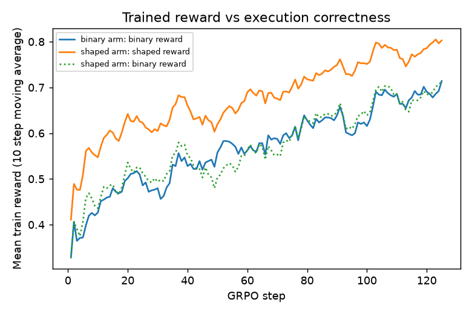

# Querycraft

Fine tuning Qwen2.5 Coder for text to SQL on BIRD, scored by execution accuracy, with a controlled study of
parameter efficient fine tuning: a LoRA rank sweep, DoRA against LoRA at an equal budget, and full fine tuning
against LoRA, including how much general coding ability each method forgets.

## Problem

Given a natural language question, an optional hint ("external knowledge") and a SQLite database, produce one SQL
query whose result equals the result of the gold query. BIRD databases are large, messy and real (up to hundreds of
columns per database), so the task tests schema understanding as much as SQL syntax.

## Protocol

| Split | Size | Source | Used for |
|---|---|---|---|
| train | see `data/processed/split_stats.json` | BIRD train minus validation databases | training only |
| val | 500 | whole BIRD train databases held out of training | every choice: checkpoints, prompts, DoRA rank |
| dev | 1,534 | BIRD dev (11 unseen databases) | final reporting only, never for selection |
| held back | 100 | written for this project on 3 BIRD dev databases | final reporting, contamination check |

* **Validation is database disjoint from train**, like BIRD dev. Splitting rows instead would let validation share
  schemas with training and overstate how well a checkpoint generalises.
* `tests/test_split.py` fails if any dev or held back database appears in train or validation, or if train and
  validation share a database. `make data` runs the same check.
* **Metric.** A prediction is correct when its result rows equal the gold rows. Comparison ignores row order unless the
  gold query has a top level `ORDER BY`, in which case order must match too, and duplicates count. The official
  BIRD criterion (`set(pred) == set(gold)`) is reported alongside for leaderboard comparability.
* **Error categories** for wrong predictions: syntax, wrong table, wrong column, wrong join, wrong aggregation,
  timeout, other. Execution errors are tagged from the SQLite message. Queries that run but return the wrong rows
  are tagged by a structural diff against gold (tables, then join tables and ON columns, then aggregates and
  GROUP BY, then columns). "Other" means the right skeleton with a wrong literal, filter or ordering.
* **Forgetting probe.** HumanEval (164) plus MBPP sanitized test (257), pass@1, greedy. The base model is a Coder
  model, so general Python coding is the ability that SQL specialisation is most likely to erode. It is also scored
  by execution, like the main metric. Two suites give 421 problems instead of 164, which narrows the confidence
  interval enough to separate methods.
* **Contamination check.** BIRD dev has been public since 2023 and may sit in pretraining data. The held back set
  asks new questions over the same three dev databases (superhero, student_club, formula_1). The report compares
  each model's held back accuracy with its dev accuracy on those same databases.

## Method

* **Prompt.** System instruction, then the schema as `CREATE TABLE` statements with key constraints and three
  example values per column, then the hint, then the question. The assistant turn is the bare SQL.
* **Schema pruning.** If the schema exceeds 1,280 tokens, tables and then columns are dropped by lexical relevance to
  the question and hint. Key columns are never dropped. Lengths before and after pruning, and the share of examples
  whose gold tables all survive, are in `data/processed/prompt_stats.json` and below.
* **Training.** TRL SFT with loss on the SQL only, 560 optimizer steps at an effective batch of 16 (about one epoch),
  cosine schedule with 3% warmup, seed 0. Every trained run sees the same examples in the same order and the same
  number of steps. LoRA family runs use lr 2e-4, alpha = 2 x rank, dropout 0.05, all linear projections. Full fine
  tuning uses lr 1e-5 with fp32 master weights (bf16 weights would round away updates of that size).
* **Selection.** Checkpoints at steps 280, 420 and 560 are scored on validation; the best one goes to dev. DoRA
  uses the rank that won the QLoRA sweep on validation.
* **Inference.** vLLM, greedy, bf16 base for every model so precision is constant across comparisons. LoRA
  checkpoints are served as adapters; DoRA checkpoints are merged first because vLLM does not serve DoRA adapters.
* **Confidence and abstention** (`querycraft/confidence.py`). Each question gets 8 sampled queries at a
  temperature chosen on val. All 8 are executed and grouped by the rows they return; the largest group's query is
  the answer, and the group's share of the 8 is the confidence. Below a threshold chosen on val, the model says it
  is not sure instead of answering.
* **Demo** (`querycraft/demo.py`). A local web page: pick a BIRD database or upload any SQLite file, ask a
  question, and see the SQL, the rows and whether the model is confident. Databases open read only and the server
  only listens on localhost. Run `pip install -r requirements-demo.txt`, then
  `python -u -m querycraft.demo configs/local/11_qwen1.5b_lora_r16.yaml` and open http://127.0.0.1:7860.
* **Audit** (`make audit`). Recounts every reported number from the per question files and re-executes a random
  sample with an independent checker that shares no code with the scoring harness.

## Results

<!-- RESULTS:START -->
### Main results (BIRD dev, execution accuracy %)

| Model | Val EX (selection) | Dev EX [95% CI] | Dev EX (BIRD official) | Simple | Moderate | Challenging | Held back EX | Dev EX on held back DBs | HumanEval | MBPP | Trained on | Train time |
|---|---|---|---|---|---|---|---|---|---|---|---|---|
| 1.5B zero shot | 24.0 | 27.44 [25.27, 29.73] | 30.9 | 34.49 | 16.59 | 17.24 | 61.0 | 32.32 | 72.56 | 65.37 |  |  |
| 1.5B few shot (3) | 21.4 | 25.95 [23.81, 28.2] | 28.29 | 32.11 | 16.59 | 16.55 | 49.0 | 29.72 |  |  |  |  |
| 1.5B QLoRA r16 | 32.2 | 42.31 [39.86, 44.8] | 47.59 | 50.05 | 32.54 | 24.14 | 66.0 | 52.49 | 68.9 | 68.09 | NVIDIA GeForce RTX 4070 Laptop GPU x1 | 2.12 h |
| 1.5B LoRA (bf16) r16 | 33.6 | 43.94 [41.47, 46.43] | 49.09 | 51.89 | 32.97 | 28.28 | 68.0 | 54.66 | 68.9 | 68.09 | NVIDIA GeForce RTX 4070 Laptop GPU x1 | 1.50 h |
| 7B zero shot | 53.2 | 51.43 [48.93, 53.93] | 56.26 | 58.16 | 43.97 | 32.41 | 88.0 | 62.91 | 87.8 | 85.6 |  |  |
| 7B few shot (3) | 50.4 | 50.13 [47.63, 52.63] | 55.74 | 57.62 | 40.73 | 32.41 | 90.0 | 60.74 |  |  |  |  |
| 7B QLoRA r8 | 56.4 | 51.69 [49.19, 54.19] | 57.63 | 59.03 | 43.75 | 30.34 | 82.0 | 62.47 | 84.76 | 84.44 | NVIDIA A100-SXM4-80GB x1 | 1.45 h |
| 7B QLoRA r16 | 56.0 | 52.15 [49.65, 54.64] | 57.95 | 59.35 | 44.83 | 29.66 | 84.0 | 63.77 | 84.15 | 83.66 | NVIDIA A100-SXM4-80GB x1 | 1.46 h |
| 7B QLoRA r64 | 56.0 | 52.67 [50.17, 55.16] | 58.15 | 59.14 | 45.91 | 33.1 | 83.0 | 62.47 | 83.54 | 82.88 | NVIDIA A100-SXM4-80GB x1 | 1.47 h |
| 7B DoRA (4 bit base) r8 | 56.4 | 51.69 [49.19, 54.19] | 57.76 | 59.14 | 43.32 | 31.03 | 83.0 | 62.69 | 85.98 | 84.44 | NVIDIA A100-SXM4-80GB x1 | 1.09 h |
| 1.5B full fine tune | 36.2 | 42.76 [40.31, 45.25] | 47.52 | 49.95 | 34.27 | 24.14 | 65.0 | 54.01 | 34.15 | 52.14 | NVIDIA A100-SXM4-80GB x1 | 0.48 h |
| 1.5B SFT LoRA + GRPO (binary reward) | 35.2 | 44.52 [42.05, 47.02] | 48.83 | 52.11 | 34.27 | 28.97 | 73.0 | 55.75 | 71.34 | 68.09 | NVIDIA GeForce RTX 4070 Laptop GPU x1 | 4.07 h |
| 1.5B SFT LoRA + GRPO (shaped reward) | 35.8 | 44.07 [41.6, 46.56] | 48.04 | 51.78 | 33.41 | 28.97 | 73.0 | 54.66 | 68.29 | 67.7 | NVIDIA GeForce RTX 4070 Laptop GPU x1 | 14.62 h |

Held back EX vs dev EX on the same three databases is the contamination check: a model that memorised BIRD dev would score clearly higher on dev questions than on new questions over the same schemas.

### Error categories on BIRD dev (count of wrong predictions)

| Model | syntax | wrong_table | wrong_column | wrong_join | wrong_aggregation | timeout | other |
|---|---|---|---|---|---|---|---|
| 1.5B zero shot | 26 | 192 | 626 | 111 | 56 | 1 | 101 |
| 1.5B few shot (3) | 30 | 187 | 660 | 94 | 61 | 2 | 102 |
| 1.5B QLoRA r16 | 1 | 243 | 307 | 145 | 78 | 0 | 111 |
| 1.5B LoRA (bf16) r16 | 3 | 241 | 268 | 155 | 75 | 0 | 118 |
| 7B zero shot | 5 | 189 | 202 | 142 | 75 | 1 | 131 |
| 7B few shot (3) | 7 | 190 | 217 | 141 | 74 | 2 | 134 |
| 7B QLoRA r8 | 1 | 192 | 162 | 170 | 74 | 0 | 142 |
| 7B QLoRA r16 | 1 | 203 | 161 | 155 | 74 | 0 | 140 |
| 7B QLoRA r64 | 2 | 197 | 157 | 153 | 76 | 0 | 141 |
| 7B DoRA (4 bit base) r8 | 1 | 201 | 155 | 164 | 77 | 0 | 143 |
| 1.5B full fine tune | 8 | 244 | 247 | 167 | 83 | 1 | 128 |
| 1.5B SFT LoRA + GRPO (binary reward) | 3 | 263 | 239 | 166 | 71 | 0 | 109 |
| 1.5B SFT LoRA + GRPO (shaped reward) | 2 | 235 | 276 | 165 | 68 | 0 | 112 |

### Checkpoint selection on validation (EX %, chosen in bold)

| Model | checkpoint-280 | checkpoint-420 | checkpoint-560 | Trainable params | Peak VRAM (GB) |
|---|---|---|---|---|---|
| 1.5B QLoRA r16 | 31.6 | 32.2 | **32.2** | 18464768 | 2.37 |
| 1.5B LoRA (bf16) r16 | 33.2 | **33.6** | 33.2 | 18464768 | 3.68 |
| 7B QLoRA r8 | 54.6 | 56.0 | **56.4** | 20185088 | 13.72 |
| 7B QLoRA r16 | 54.0 | 55.4 | **56.0** | 40370176 | 13.83 |
| 7B QLoRA r64 | 52.0 | 54.6 | **56.0** | 161480704 | 14.74 |
| 7B DoRA (4 bit base) r8 | 54.4 | 54.6 | **56.4** | 21575680 | 16.93 |
| 1.5B full fine tune | 33.4 | 34.0 | **36.2** | all | 26.95 |

| Model | checkpoint-25 | checkpoint-50 | checkpoint-75 | checkpoint-100 | checkpoint-125 | Trainable params | Peak VRAM (GB) |
|---|---|---|---|---|---|---|---|
| 1.5B SFT LoRA + GRPO (binary reward) | 32.8 | 33.4 | 34.0 | 34.0 | **35.2** | 18464768 | 6.62 |
| 1.5B SFT LoRA + GRPO (shaped reward) | 32.8 | 34.0 | 34.0 | 34.6 | **35.8** | 18464768 | 6.48 |

### GRPO on top of SFT, paired against its SFT parent (BIRD dev)

Both arms start from the 1.5B LoRA r16 SFT checkpoint and train 125 steps on 1,000 prompts the SFT model solves 1 to 7 times out of 8. p is an exact two sided sign test on the questions where exactly one of the two models is right.

| Model | SFT parent EX | GRPO EX | Only GRPO right | Only SFT right | p |
|---|---|---|---|---|---|
| 1.5B SFT LoRA + GRPO (binary reward) | 43.94 | 44.52 | 73 | 64 | 0.494 |
| 1.5B SFT LoRA + GRPO (shaped reward) | 43.94 | 44.07 | 81 | 79 | 0.937 |

### Knowing when it is wrong: voting and abstention (BIRD dev)

8 sampled queries per question are executed and grouped by result; the largest group is the answer and its share is the confidence. Temperature and thresholds are chosen on val; the threshold columns answer only questions at or above the val threshold that kept 50% or 70% of val questions.

| Model | Single answer EX | Vote of 8 EX | Confidence AUROC | Answers at val 50% threshold | EX there | Answers at val 70% threshold | EX there | Held back EX at val 50% threshold |
|---|---|---|---|---|---|---|---|---|
| 1.5B zero shot | 27.44 | 37.38 | 0.7693 | 56.23% | 54.29 | 84.67% | 43.68 | 86.3 (73.0% answered) |
| 1.5B QLoRA r16 | 42.31 | 45.6 | 0.7494 | 56.03% | 61.23 | 85.91% | 51.03 | 87.14 (70.0% answered) |
| 1.5B LoRA (bf16) r16 | 43.94 | 48.53 | 0.7411 | 56.49% | 64.09 | 81.41% | 55.29 | 90.77 (65.0% answered) |



<!-- RESULTS:END -->

### What GRPO showed

* Train reward climbed steadily (binary arm: mean 0.46 over the first 25 steps, 0.69 over the last 25), yet BIRD dev barely moved:
  +0.58 points for the binary reward and +0.13 for the shaped reward, neither distinguishable from noise in the
  paired test above (p = 0.49 and 0.94). Held back EX went from 68 to 73 for both arms, on only 100 questions.
* The shaped reward was not hacked: in the plot, the shaped arm's true correctness (dotted) tracks the binary arm
  step for step, so partial credit for the right tables and joins did not pull the model away from correct answers.
  It also did not help.
* In the binary arm, from the first 25 steps to the last 25, the share of prompts where all 8 samples got the same reward rose from 0.17 to 0.43 and entropy
  fell from 0.16 to 0.06. That is consistent with the model sharpening on answers it could already sometimes reach,
  rather than learning new skills, which matches the small dev change.
* No meaningful forgetting: HumanEval and MBPP stayed within a point of the SFT model or above it.
* The shaped arm's 14.6 h train time includes the hours the laptop was asleep overnight; it is not a compute
  comparison with the binary arm.

## Hardware

| Runs | Hardware |
|---|---|
| data, tests, 1.5B baselines, 1.5B QLoRA and LoRA, GRPO, smoke test | Lenovo Legion Pro 5, RTX 4070 Laptop 8 GB, WSL2 Ubuntu 24.04, driver 560.94 |
| 7B baselines, 7B rank sweep, 7B DoRA, 1.5B full fine tune | 1x A100 SXM4 80GB on Modal, free monthly credit |

The exact GPU, package versions, git commit, seed, config and wall clock of every stage are written to
`runs/<name>/<stage>_meta.json`. Every A100 job's measured hours and cost are in `docs/modal_ledger.json`:
9.8 A100 hours and $29.41 at the ledger's conservative $3 per hour, inside the $30 monthly free credit (including
the smoke test). DoRA appears three times because two attempts were cut off by the launcher, not the job, and each
retry resumed from the last saved checkpoint.

## Reproduce

```bash
make env                      # venv with torch 2.13 cu129 + vLLM 0.32 cu129, then a GPU check
make all PROFILE=local        # data, tests, 1.5B baselines, 1.5B QLoRA + LoRA, report
make smoke                    # rehearse the rented session on Qwen2.5 Coder 0.5B with 20 examples
# A100 jobs on Modal (spend capped per credit cycle; see querycraft/budget.py):
modal run scripts/modal_app.py::prepare            # BIRD onto the volume, splits, tests (CPU)
modal run --detach scripts/modal_app.py            # every 7B job + 1.5B full fine tune that fits the cap
modal volume get querycraft-vol runs/<name> runs/  # copy each run back, then:
make report && make audit
```

`scripts/runpod_session.sh` runs the same queue on any single rented GPU box instead.

Individual stages: `python -m querycraft.train <config>`, `python -m querycraft.run_eval <config>`,
`python -m querycraft.evaluate <predictions.jsonl>`.

## Repository

```
querycraft/   data.py (splits, leakage check)  schema.py (serializer, pruning)  prompts.py
              train.py (training only)  infer.py (vLLM inference only)  evaluate.py + execution.py (scoring only)
              run_eval.py (selection on val, then dev)  forgetting.py  report.py
configs/      base.yaml, train.yaml, local/, rented/, smoke/
data/heldback the 100 project written questions (draft.py validates every gold query)
tests/        harness, split + leakage, schema
```

## What did not work

* **First pruning design.** Dropping whole tables by lexical relevance while keeping every kept table in full detail
  (types and example values) lost a gold table in 38.6% of validation prompts and 15.1% of dev prompts at a 1,280 token
  budget. Showing low relevance tables in compact form (names and keys only) before dropping anything, plus a score
  boost for tables one foreign key away from a relevant table, raised validation gold table recall to 96.2% at the same
  budget. A 1,536 token budget only added 1.4 points on validation, so 1,280 stayed.
* **Row level validation split.** Rejected before any run: validation rows from training databases would share schemas
  with training, unlike BIRD dev, and would reward schema memorisation when picking checkpoints.
* **Latest vLLM on the laptop.** vLLM 0.33 needs torch 2.14 built for CUDA 13, which driver 560 (CUDA 12.6) cannot
  run. The stack is pinned to vLLM 0.32 and torch 2.13 cu129 builds, which run through CUDA minor version
  compatibility. Two more fixes were needed: removing a CUDA 13 `torchcodec` build that crashed vLLM at import, and
  installing `python3-dev`, because Triton compiles a C helper at runtime.
* **Full fine tuning on 8 GB.** 1.5B parameters with fp32 master weights, fp32 gradients and AdamW states need about
  24 GB before activations. Even bf16 weights with 8 bit AdamW need about 9 GB. Full fine tuning was moved to the A100;
  its LoRA partner trains on the laptop with the identical recipe.
* **FlashInfer sampler on a driver only machine.** vLLM 0.32 compiles a FlashInfer top k / top p sampling kernel at
  startup, which needs `nvcc`. WSL and slim pod images ship only the driver, so the first baseline crashed. Greedy
  decoding needs no such kernel, so `VLLM_USE_FLASHINFER_SAMPLER=0` is set before vLLM is imported.
* **Accuracy targets for abstention.** Thresholds were first chosen on val to reach 60%, 70% or 80% accuracy.
  Val uses databases never seen in training and is much harder than dev, so even unanimous answers only reached
  58% there and no threshold qualified for the fine tuned models. Choosing thresholds by the share of val
  questions answered transfers to dev far better and is what the table reports.
* **7B on the 8 GB laptop.** 7B QLoRA training fits only by spilling about 1 GB into system memory, at 67 seconds
  per step (about 10 hours per run), and vLLM 0.32 no longer serves the bitsandbytes 4 bit format, so 7B could not
  be evaluated locally. All 7B runs moved to Modal's free monthly credit behind a spend cap
  (`querycraft/budget.py`) that only starts a job if its worst case cost still fits.
* **BIRD archive layout.** The train archive ships macOS `__MACOSX` resource fork files that mirror every database
  path. A naive path search picked them first, so validation pointed at non databases. The loader now skips them.
