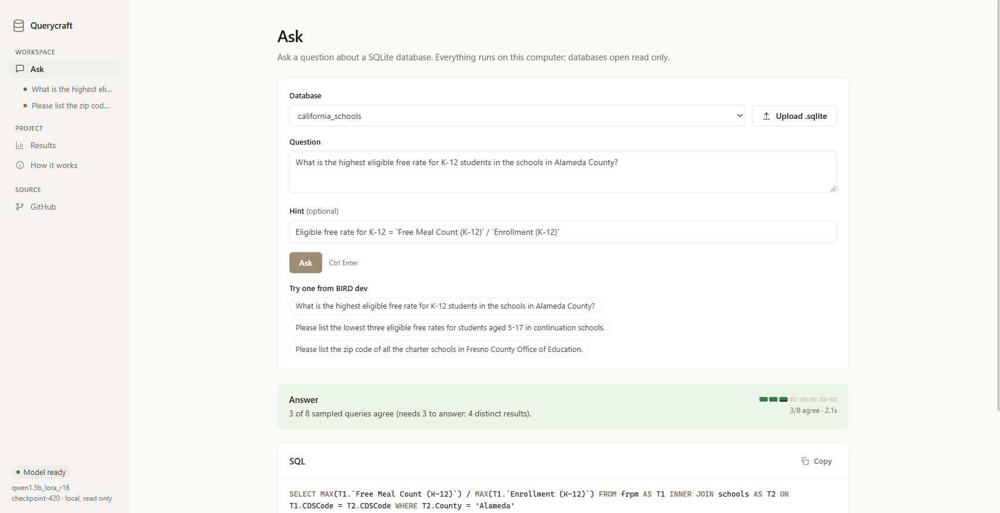
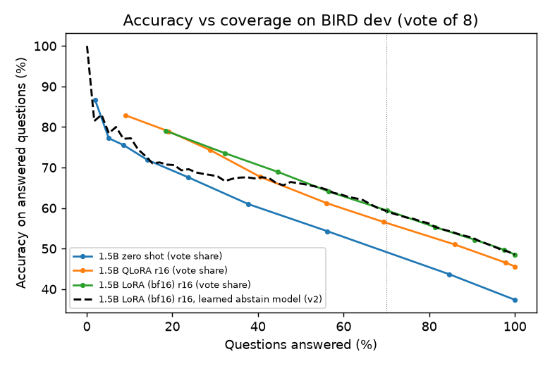

# Querycraft

**Ask an analytics question in English and get back checked SQL, the rows, and an honest "not sure": a fine tuned 1.5B text to SQL model with a trained table retriever, a run and repair loop, and a calibrated abstain model, served behind an API, an MCP server and a dashboard, all on one laptop for $0.**


It started as a controlled study of parameter efficient fine tuning for text to SQL on BIRD (v1, below, unchanged)
and became a deployed agent (v2). Every number here is generated from `runs/` by `querycraft/report.py`, with a
paired exact sign test or a 95% interval; anything not measured yet says TBD.

## Results at a glance

<!-- HEADLINE:START -->
| Measure | Result |
|---|---|
| Every gold table kept, dev (trained retriever vs v1 selector) | 0.9478 vs 0.8227 (5.07 vs 1.91 tables shown) |
| Dev EX, 1.5B SFT: retrieved tables vs full pruned schema | 43.22 vs 43.94 (p = 0.294) |
| Dev EX, 1.5B SFT LoRA: agent vs single pass (vs its own retrieved single pass) | 44.59 vs 43.94 (p = 0.363); vs 43.22 (p < 0.001) |
| Dev EX, 7B SFT DoRA (T4, fp16): agent vs single pass (vs its own retrieved single pass) | TBD |
| Dev accuracy at 70% answered: learned abstain vs vote share | 59.18 vs 59.46 (p = 0.795) |
| Dev EX, 1.5B 4 bit AWQ vs bf16 | 39.7 vs 43.94 (p < 0.001) |
| 1.5B bf16_lora on the laptop: p50 latency at 1 user; $ per 1k queries at 32 users (L4 price) | 960.0 ms; $0.0105 |
| 1.5B bf16_merged on the laptop: p50 latency at 1 user; $ per 1k queries at 32 users (L4 price) | 790.0 ms; $0.0087 |
| 1.5B awq_w4a16 on the laptop: p50 latency at 1 user; $ per 1k queries at 32 users (L4 price) | 360.0 ms; $0.0064 |
<!-- HEADLINE:END -->

## Findings (v2: from study to agent)

Backed by the paired tests and intervals in [Results](#results) (v2 tables follow the v1 ones there).

1. **A trained table retriever fixes recall but not accuracy.** The fine tuned bi encoder (val chose its top 2
   tables plus one foreign key hop) keeps every needed table for 94.8% of dev questions against 82.3% for the v1
   selector, but it shows 5.1 of about 7 tables, close to the full schema. The SQL model's dev EX is 43.22 against
   43.94 without it (40 newly right, 51 newly wrong, p = 0.29): it recovers -15.7% of the oracle's 4.6 point gain
   (95% interval -55.9 to 9.8). The oracle gains by showing about 2 exactly right tables; neither high recall nor
   high precision alone gets there.
2. **A run and repair loop fixes the model's own mistakes.** On dev the agent scores 44.59 against 43.22 for the
   same model's first attempt over the same tables (24 newly right, 3 newly wrong, p < 0.001); 21% of dev questions
   trigger a rewrite, from an error or an empty result, at 3.6 tool calls and about 2,000 tokens per question. Against
   the v1 model with the full pruned schema the gain is not significant (44.59 against 43.94, p = 0.36), because the
   retriever costs what the loop wins back. Latency, one question at a time on 50 dev questions: p50 789 ms against
   651 ms for a single pass, p90 3.7 s against 1.0 s.
3. **A learned abstain model is better calibrated, not better at choosing.** On dev, LightGBM with Platt scaling has
   ECE 0.094 against 0.137 for raw vote share and Brier 0.223 against 0.229, but AUROC 0.722 against 0.741. Answering
   70% of dev, accuracy is 59.18 against 59.46 (p = 0.79, difference interval -1.3 to 0.9 points). Vote share already
   carries the signal; the extra features only fix its scale. Against the agent's answers, which the API returns, its
   ECE is 0.063.
4. **4 bit AWQ is 2.2 times faster and costs 4 points.** On the laptop GPU, AWQ answers one request in 360 ms (p50)
   against 790 ms for the same weights merged in bf16 and 960 ms for base + LoRA adapter, and serves 34.7 requests per
   second at 32 users against 25.7 and 21.2. But dev EX falls from 43.94 to 39.7 (51 newly right, 116 newly wrong,
   p < 0.001), calibrated on 64 val prompts. At the measured throughput and an L4's $0.80/h, 1,000 queries cost $0.0064
   (AWQ), $0.0087 (bf16 merged), $0.0105 (bf16 + adapter).
5. **On a real warehouse the numbers are too small to separate systems.** Over 2,000,000 Iowa Liquor Sales invoice
   lines, the agent answers 15 of 30 new questions (50.0%, 95% interval 33 to 67) against 46.7% for a single pass
   (p = 1.0). The questions still need human review.
6. **The CI gate and the drift report catch what they should.** Replaying cached completions on 200 val questions
   reproduces the saved EX (38.0) exactly, and changing one word of the system prompt fails the build. The drift
   report flags the Iowa traffic as shorter (10.4 against 13.6 words, p = 0.0015) and more confident than val, with
   97% of questions on a database the system was never tuned on.
7. **7B rows are TBD.** They need the Kaggle notebooks (`notebooks/kaggle_{a,b,c}_*.ipynb`); no 7B v2 number exists.

## Findings (v1: fine tuning study)

Every claim below is backed by a paired test or a confidence interval in [Results](#results).

1. **At 1.5B, supervised fine tuning works.** LoRA r16 lifts BIRD dev execution accuracy from 27.44 to 43.94
   (320 questions newly right, 67 newly wrong, p < 0.001).
2. **At 7B, it does not beat zero shot.** The best 7B fine tune (QLoRA r64) scores 52.67 against 51.43 zero shot
   (p = 0.23), and no 7B run gets below p = 0.23. On the held back set every 7B fine tune scores lower than zero shot
   (82 to 84 against 88), though with 100 questions none of those drops is significant either. Qwen2.5 Coder 7B
   Instruct already knows what BIRD's training set teaches at this prompt format.
3. **Rank and method barely matter.** At 7B, QLoRA r8, r16, r64 and DoRA land within one point of each other with
   overlapping 95% intervals, while r64 trains 8 times as many parameters as r8.
4. **Full fine tuning costs general coding ability for no gain.** At 1.5B it matches LoRA on BIRD (42.76 against
   43.94) but HumanEval drops from 72.56 (base) to 34.15, against 68.9 for LoRA.
5. **Reinforcement learning with an execution reward (GRPO) did not help**, with either a binary or a shaped reward
   (p = 0.49 and 0.94 against its SFT starting point), and the shaped reward was not exploited.
6. **Picking the right tables is worth about 4.6 points, and the easy way to pick them does not get it.** Showing
   the 1.5B SFT model only the tables its gold query uses (an oracle, so an upper bound) lifts dev from 43.94 to
   48.50 (p < 0.001) and halves wrong table errors. Letting the model's own first answer pick the tables (plus one
   foreign key hop) gains only 0.5 on dev (p = 0.40), though 8 points on the held back set (p = 0.008, 100 questions).
   A selector trained to list the tables is 91% precise but drops a needed table for 18% of dev questions, and
   gains 0.8 (p = 0.42). The bottleneck is selector recall, not the SQL model.
7. **No sign of memorised BIRD dev.** Every model scores higher on the new held back questions than on dev questions
   over the same three databases, the opposite of what memorisation would produce. The held back questions are
   probably easier than BIRD's, so this is a one sided check.

## Problem

Given a natural language question, an optional hint ("external knowledge") and a SQLite database, produce one SQL
query whose result equals the result of the gold query. BIRD databases are large, messy and real (up to hundreds of
columns per database), so the task tests schema understanding as much as SQL syntax.

## Protocol

| Split | Size | Source | Used for |
|---|---|---|---|
| train | see `data/processed/split_stats.json` | BIRD train minus validation databases | training only |
| val | 500 | whole BIRD train databases held out of training | every choice: checkpoints, prompts, DoRA rank |
| dev | 1,534 | BIRD dev (11 unseen databases) | final reporting only, never for selection |
| held back | 100 | AI drafted for this project on 3 BIRD dev databases; every gold query validated by execution and given a second AI review ([docs/heldback_review.md](docs/heldback_review.md): 2 questions have a tied answer, changing no conclusion), not yet human reviewed | final reporting, contamination check |

* **Validation is database disjoint from train**, like BIRD dev. Splitting rows instead would let validation share
  schemas with training and overstate how well a checkpoint generalises.
* `tests/test_split.py` fails if any dev or held back database appears in train or validation, or if train and
  validation share a database. `make data` runs the same check.
* **Metric.** A prediction is correct when its result rows equal the gold rows. Comparison ignores row order unless the
  gold query has a top level `ORDER BY`, in which case order must match too, and duplicates count. The official
  BIRD criterion (`set(pred) == set(gold)`) is reported alongside for leaderboard comparability.
* **Error categories** for wrong predictions: syntax, wrong table, wrong column, wrong join, wrong aggregation,
  timeout, other. Execution errors are tagged from the SQLite message. Queries that run but return the wrong rows
  are tagged by a structural diff against gold (tables, then join tables and ON columns, then aggregates and
  GROUP BY, then columns). "Other" means the right skeleton with a wrong literal, filter or ordering.
* **Forgetting probe.** HumanEval (164) plus MBPP sanitized test (257), pass@1, greedy. The base model is a Coder
  model, so general Python coding is the ability that SQL specialisation is most likely to erode. It is also scored
  by execution, like the main metric. Two suites give 421 problems instead of 164, which narrows the confidence
  interval enough to separate methods.
* **Contamination check.** BIRD dev has been public since 2023 and may sit in pretraining data. The held back set
  asks new questions over the same three dev databases (superhero, student_club, formula_1). The report compares
  each model's held back accuracy with its dev accuracy on those same databases.

## Method

* **Prompt.** System instruction, then the schema as `CREATE TABLE` statements with key constraints and three
  example values per column, then the hint, then the question. The assistant turn is the bare SQL.
* **Schema pruning.** If the schema exceeds 1,280 tokens, tables and then columns are dropped by lexical relevance to
  the question and hint. Key columns are never dropped. Lengths before and after pruning, and the share of examples
  whose gold tables all survive, are in `data/processed/prompt_stats.json` and below.
* **Training.** TRL SFT with loss on the SQL only, 560 optimizer steps at an effective batch of 16 (about one epoch),
  cosine schedule with 3% warmup, seed 0. Every trained run sees the same examples in the same order and the same
  number of steps. LoRA family runs use lr 2e-4, alpha = 2 x rank, dropout 0.05, all linear projections. Full fine
  tuning uses lr 1e-5 with fp32 master weights (bf16 weights would round away updates of that size).
* **Selection.** Checkpoints at steps 280, 420 and 560 are scored on validation; the best one goes to dev. DoRA
  uses the rank that won the QLoRA sweep on validation.
* **Inference.** vLLM, greedy, bf16 base for every model so precision is constant across comparisons. LoRA
  checkpoints are served as adapters; DoRA checkpoints are merged first because vLLM does not serve DoRA adapters.
* **Confidence and abstention** (`querycraft/confidence.py`). Each question gets 8 sampled queries at a
  temperature chosen on val. All 8 are executed and grouped by the rows they return; the largest group's query is
  the answer, and the group's share of the 8 is the confidence. Below a threshold chosen on val, the model says it
  is not sure instead of answering.
* **Demo** (`querycraft/demo.py`). A local web page: pick a BIRD database or upload any SQLite file, ask a
  question, and see the SQL, the rows and whether the model is confident. Databases open read only and the server
  only listens on localhost. It also shows every run's results. No extra dependencies: the page is one HTML file
  served by the standard library. Run `python -u -m querycraft.demo configs/local/11_qwen1.5b_lora_r16.yaml` and
  open http://127.0.0.1:7860.

  

  Real output of the 1.5B LoRA model on a BIRD dev question. It passed the confidence threshold (3 of 8 sampled
  queries agree), yet the query is wrong: it takes the maximum of each column separately instead of the maximum of
  their ratio. At 44% dev accuracy, mistakes like this are common, which is why the page shows the SQL.
* **Audit** (`make audit`). Recounts every reported number from the per question files and re-executes a random
  sample with an independent checker that shares no code with the scoring harness.

## Results

<!-- RESULTS:START -->
### Main results (BIRD dev, execution accuracy %)

| Model | Val EX (selection) | Dev EX [95% CI] | Dev EX (BIRD official) | Simple | Moderate | Challenging | Held back EX | Dev EX on held back DBs | HumanEval | MBPP | Trained on | Train time |
|---|---|---|---|---|---|---|---|---|---|---|---|---|
| 1.5B zero shot | 24.0 | 27.44 [25.27, 29.73] | 30.9 | 34.49 | 16.59 | 17.24 | 61.0 | 32.32 | 72.56 | 65.37 |  |  |
| 1.5B few shot (3) | 21.4 | 25.95 [23.81, 28.2] | 28.29 | 32.11 | 16.59 | 16.55 | 49.0 | 29.72 |  |  |  |  |
| 1.5B QLoRA r16 | 32.2 | 42.31 [39.86, 44.8] | 47.59 | 50.05 | 32.54 | 24.14 | 66.0 | 52.49 | 68.9 | 68.09 | NVIDIA GeForce RTX 4070 Laptop GPU x1 | 2.12 h |
| 1.5B LoRA (bf16) r16 | 33.6 | 43.94 [41.47, 46.43] | 49.09 | 51.89 | 32.97 | 28.28 | 68.0 | 54.66 | 68.9 | 68.09 | NVIDIA GeForce RTX 4070 Laptop GPU x1 | 1.50 h |
| 7B zero shot | 53.2 | 51.43 [48.93, 53.93] | 56.26 | 58.16 | 43.97 | 32.41 | 88.0 | 62.91 | 87.8 | 85.6 |  |  |
| 7B few shot (3) | 50.4 | 50.13 [47.63, 52.63] | 55.74 | 57.62 | 40.73 | 32.41 | 90.0 | 60.74 |  |  |  |  |
| 7B QLoRA r8 | 56.4 | 51.69 [49.19, 54.19] | 57.63 | 59.03 | 43.75 | 30.34 | 82.0 | 62.47 | 84.76 | 84.44 | NVIDIA A100-SXM4-80GB x1 | 1.45 h |
| 7B QLoRA r16 | 56.0 | 52.15 [49.65, 54.64] | 57.95 | 59.35 | 44.83 | 29.66 | 84.0 | 63.77 | 84.15 | 83.66 | NVIDIA A100-SXM4-80GB x1 | 1.46 h |
| 7B QLoRA r64 | 56.0 | 52.67 [50.17, 55.16] | 58.15 | 59.14 | 45.91 | 33.1 | 83.0 | 62.47 | 83.54 | 82.88 | NVIDIA A100-SXM4-80GB x1 | 1.47 h |
| 7B DoRA (4 bit base) r8 | 56.4 | 51.69 [49.19, 54.19] | 57.76 | 59.14 | 43.32 | 31.03 | 83.0 | 62.69 | 85.98 | 84.44 | NVIDIA A100-SXM4-80GB x1 | 1.09 h |
| 1.5B full fine tune | 36.2 | 42.76 [40.31, 45.25] | 47.52 | 49.95 | 34.27 | 24.14 | 65.0 | 54.01 | 34.15 | 52.14 | NVIDIA A100-SXM4-80GB x1 | 0.48 h |
| 1.5B SFT LoRA + GRPO (binary reward) | 35.2 | 44.52 [42.05, 47.02] | 48.83 | 52.11 | 34.27 | 28.97 | 73.0 | 55.75 | 71.34 | 68.09 | NVIDIA GeForce RTX 4070 Laptop GPU x1 | 4.07 h |
| 1.5B SFT LoRA + GRPO (shaped reward) | 35.8 | 44.07 [41.6, 46.56] | 48.04 | 51.78 | 33.41 | 28.97 | 73.0 | 54.66 | 68.29 | 67.7 | NVIDIA GeForce RTX 4070 Laptop GPU x1 | 14.62 h |
| 1.5B SFT LoRA, oracle tables (upper bound) | 45.0 | 48.5 [46.01, 51.0] | 54.17 | 58.49 | 35.34 | 26.9 | 79.0 | 61.61 |  |  |  |  |
| 1.5B SFT LoRA, self linked tables (2 pass) | 36.6 | 44.46 [41.99, 46.96] | 49.54 | 52.43 | 33.19 | 29.66 | 76.0 | 54.45 |  |  |  |  |
| 1.5B SFT LoRA, trained table selector (2 pass) | 34.4 | 44.72 [42.25, 47.22] | 49.87 | 54.49 | 31.03 | 26.21 | 63.0 | 55.75 |  |  |  |  |
| 1.5B SFT LoRA, trained table retriever (2 pass) | 35.6 | 43.22 [40.76, 45.71] | 48.24 | 51.57 | 32.11 | 25.52 | 68.0 | 54.01 |  |  |  |  |

Held back EX vs dev EX on the same three databases is the contamination check: a model that memorised BIRD dev would score clearly higher on dev questions than on new questions over the same schemas.

### Error categories on BIRD dev (count of wrong predictions)

| Model | syntax | wrong_table | wrong_column | wrong_join | wrong_aggregation | timeout | other |
|---|---|---|---|---|---|---|---|
| 1.5B zero shot | 26 | 192 | 626 | 111 | 56 | 1 | 101 |
| 1.5B few shot (3) | 30 | 187 | 660 | 94 | 61 | 2 | 102 |
| 1.5B QLoRA r16 | 1 | 243 | 307 | 145 | 78 | 0 | 111 |
| 1.5B LoRA (bf16) r16 | 3 | 241 | 268 | 155 | 75 | 0 | 118 |
| 7B zero shot | 5 | 189 | 202 | 142 | 75 | 1 | 131 |
| 7B few shot (3) | 7 | 190 | 217 | 141 | 74 | 2 | 134 |
| 7B QLoRA r8 | 1 | 192 | 162 | 170 | 74 | 0 | 142 |
| 7B QLoRA r16 | 1 | 203 | 161 | 155 | 74 | 0 | 140 |
| 7B QLoRA r64 | 2 | 197 | 157 | 153 | 76 | 0 | 141 |
| 7B DoRA (4 bit base) r8 | 1 | 201 | 155 | 164 | 77 | 0 | 143 |
| 1.5B full fine tune | 8 | 244 | 247 | 167 | 83 | 1 | 128 |
| 1.5B SFT LoRA + GRPO (binary reward) | 3 | 263 | 239 | 166 | 71 | 0 | 109 |
| 1.5B SFT LoRA + GRPO (shaped reward) | 2 | 235 | 276 | 165 | 68 | 0 | 112 |
| 1.5B SFT LoRA, oracle tables (upper bound) | 3 | 116 | 241 | 185 | 90 | 0 | 155 |
| 1.5B SFT LoRA, self linked tables (2 pass) | 4 | 244 | 254 | 148 | 79 | 0 | 123 |
| 1.5B SFT LoRA, trained table selector (2 pass) | 10 | 250 | 241 | 131 | 81 | 0 | 135 |
| 1.5B SFT LoRA, trained table retriever (2 pass) | 6 | 263 | 258 | 143 | 80 | 0 | 121 |

### Checkpoint selection on validation (EX %, chosen in bold)

| Model | checkpoint-280 | checkpoint-420 | checkpoint-560 | Trainable params | Peak VRAM (GB) |
|---|---|---|---|---|---|
| 1.5B QLoRA r16 | 31.6 | 32.2 | **32.2** | 18464768 | 2.37 |
| 1.5B LoRA (bf16) r16 | 33.2 | **33.6** | 33.2 | 18464768 | 3.68 |
| 7B QLoRA r8 | 54.6 | 56.0 | **56.4** | 20185088 | 13.72 |
| 7B QLoRA r16 | 54.0 | 55.4 | **56.0** | 40370176 | 13.83 |
| 7B QLoRA r64 | 52.0 | 54.6 | **56.0** | 161480704 | 14.74 |
| 7B DoRA (4 bit base) r8 | 54.4 | 54.6 | **56.4** | 21575680 | 16.93 |
| 1.5B full fine tune | 33.4 | 34.0 | **36.2** | all | 26.95 |

| Model | checkpoint-25 | checkpoint-50 | checkpoint-75 | checkpoint-100 | checkpoint-125 | Trainable params | Peak VRAM (GB) |
|---|---|---|---|---|---|---|---|
| 1.5B SFT LoRA + GRPO (binary reward) | 32.8 | 33.4 | 34.0 | 34.0 | **35.2** | 18464768 | 6.62 |
| 1.5B SFT LoRA + GRPO (shaped reward) | 32.8 | 34.0 | 34.0 | 34.6 | **35.8** | 18464768 | 6.48 |

### Does fine tuning beat zero shot? Paired against the same size zero shot model

p is an exact two sided sign test on the questions where exactly one of the two models is right (dev: 1,534 questions, held back: 100).

| Model | Zero shot dev EX | Dev EX | Only FT right | Only zero shot right | p | Zero shot held back | Held back | Only FT right | Only zero shot right | p |
|---|---|---|---|---|---|---|---|---|---|---|
| 1.5B QLoRA r16 | 27.44 | 42.31 | 300 | 72 | <0.001 | 61.0 | 66.0 | 14 | 9 | 0.405 |
| 1.5B LoRA (bf16) r16 | 27.44 | 43.94 | 320 | 67 | <0.001 | 61.0 | 68.0 | 15 | 8 | 0.21 |
| 7B QLoRA r8 | 51.43 | 51.69 | 115 | 111 | 0.842 | 88.0 | 82.0 | 4 | 10 | 0.18 |
| 7B QLoRA r16 | 51.43 | 52.15 | 119 | 108 | 0.507 | 88.0 | 84.0 | 4 | 8 | 0.388 |
| 7B QLoRA r64 | 51.43 | 52.67 | 121 | 102 | 0.228 | 88.0 | 83.0 | 5 | 10 | 0.302 |
| 7B DoRA (4 bit base) r8 | 51.43 | 51.69 | 114 | 110 | 0.841 | 88.0 | 83.0 | 4 | 9 | 0.267 |
| 1.5B full fine tune | 27.44 | 42.76 | 323 | 88 | <0.001 | 61.0 | 65.0 | 19 | 15 | 0.608 |

### Built on an SFT model, paired against it

GRPO arms start from the 1.5B LoRA r16 SFT checkpoint and train 125 steps on 1,000 prompts the SFT model solves 1 to 7 times out of 8. Schema linking runs use an SFT model unchanged (1.5B LoRA r16, or the 7B DoRA run) and only change which tables the prompt shows (`docs/plans/schema_linking.md`); the oracle row uses the gold SQL's tables and is an upper bound, not a usable system. p is an exact two sided sign test on the questions where exactly one of the two models is right.

| Model | SFT dev EX | Dev EX | Only new right | Only SFT right | p | SFT held back | Held back | Only new right | Only SFT right | p |
|---|---|---|---|---|---|---|---|---|---|---|
| 1.5B SFT LoRA + GRPO (binary reward) | 43.94 | 44.52 | 73 | 64 | 0.494 | 68.0 | 73.0 | 10 | 5 | 0.302 |
| 1.5B SFT LoRA + GRPO (shaped reward) | 43.94 | 44.07 | 81 | 79 | 0.937 | 68.0 | 73.0 | 7 | 2 | 0.18 |
| 1.5B SFT LoRA, oracle tables (upper bound) | 43.94 | 48.5 | 134 | 64 | <0.001 | 68.0 | 79.0 | 14 | 3 | 0.013 |
| 1.5B SFT LoRA, self linked tables (2 pass) | 43.94 | 44.46 | 39 | 31 | 0.403 | 68.0 | 76.0 | 8 | 0 | 0.008 |
| 1.5B SFT LoRA, trained table selector (2 pass) | 43.94 | 44.72 | 97 | 85 | 0.415 | 68.0 | 63.0 | 4 | 9 | 0.267 |
| 1.5B SFT LoRA, trained table retriever (2 pass) | 43.94 | 43.22 | 40 | 51 | 0.294 | 68.0 | 68.0 | 3 | 3 | 1.0 |

### Knowing when it is wrong: voting and abstention (BIRD dev)

8 sampled queries per question are executed and grouped by result; the largest group is the answer and its share is the confidence. Temperature and thresholds are chosen on val; the threshold columns answer only questions at or above the val threshold that kept 50% or 70% of val questions.

| Model | Single answer EX | Vote of 8 EX | Confidence AUROC | Answers at val 50% threshold | EX there | Answers at val 70% threshold | EX there | Held back EX at val 50% threshold |
|---|---|---|---|---|---|---|---|---|
| 1.5B zero shot | 27.44 | 37.38 | 0.7693 | 56.23% | 54.29 | 84.67% | 43.68 | 86.3 (73.0% answered) |
| 1.5B QLoRA r16 | 42.31 | 45.6 | 0.7494 | 56.03% | 61.23 | 85.91% | 51.03 | 87.14 (70.0% answered) |
| 1.5B LoRA (bf16) r16 | 43.94 | 48.53 | 0.7411 | 56.49% | 64.09 | 81.41% | 55.29 | 90.77 (65.0% answered) |

### Picking the tables: set metrics (v2 part 1)

Gold tables come from the gold SQL. "Every gold table kept" is the share of questions whose prompt can contain everything the answer needs. Self linking and the selector are the v1 rows; the retriever's source, k and foreign key hop were chosen by second pass val EX (chosen: **bi_k2_hop**).

| Method | Split | Recall | Precision | Every gold table kept | Mean tables shown |
|---|---|---|---|---|---|
| Self linking (first pass tables + 1 FK hop) | val | 0.9776 | 0.2057 | 0.962 | 9.34 |
| Trained table selector (lists tables) | val | 0.8271 | 0.8469 | 0.71 | 1.92 |
| Retriever, bi encoder, top 2 | val | 0.6399 | 0.629 | 0.41 | 2.0 |
| **Retriever, bi encoder, top 2 + 1 FK hop** | val | 0.939 | 0.2531 | 0.898 | 7.29 |
| Retriever, bi encoder, top 3 | val | 0.7386 | 0.484 | 0.55 | 3.0 |
| Retriever, bi encoder, top 4 | val | 0.8098 | 0.398 | 0.652 | 4.0 |
| Retriever, bi encoder, top 5 | val | 0.8505 | 0.3344 | 0.726 | 5.0 |
| Retriever, bi encoder + cross encoder rerank, top 2 | val | 0.767 | 0.754 | 0.622 | 2.0 |
| Retriever, bi encoder + cross encoder rerank, top 3 | val | 0.8545 | 0.56 | 0.734 | 3.0 |
| Retriever, bi encoder + cross encoder rerank, top 4 | val | 0.9034 | 0.444 | 0.82 | 4.0 |
| Retriever, bi encoder + cross encoder rerank, top 5 | val | 0.9318 | 0.3664 | 0.872 | 5.0 |
| Self linking (first pass tables + 1 FK hop) | dev | 0.9833 | 0.3771 | 0.9739 | 5.08 |
| Trained table selector (lists tables) | dev | 0.889 | 0.9078 | 0.8227 | 1.91 |
| Retriever, bi encoder, top 2 | dev | 0.7432 | 0.7246 | 0.5828 | 2.0 |
| **Retriever, bi encoder, top 2 + 1 FK hop** | dev | 0.9672 | 0.3716 | 0.9478 | 5.07 |
| Retriever, bi encoder, top 3 | dev | 0.885 | 0.5752 | 0.8142 | 3.0 |
| Retriever, bi encoder, top 4 | dev | 0.9398 | 0.4777 | 0.899 | 3.84 |
| Retriever, bi encoder, top 5 | dev | 0.9662 | 0.4116 | 0.9407 | 4.58 |
| Retriever, bi encoder + cross encoder rerank, top 2 | dev | 0.8091 | 0.7888 | 0.6897 | 2.0 |
| Retriever, bi encoder + cross encoder rerank, top 3 | dev | 0.9214 | 0.5989 | 0.8735 | 3.0 |
| Retriever, bi encoder + cross encoder rerank, top 4 | dev | 0.9616 | 0.4888 | 0.9394 | 3.84 |
| Retriever, bi encoder + cross encoder rerank, top 5 | dev | 0.9806 | 0.4177 | 0.9694 | 4.58 |

On dev the retriever second pass recovers **-15.7%** of the oracle's gain over the SFT model (paired bootstrap 95% interval [-55.9, 9.8], 2,000 resamples of the 1,534 questions). The trained selector recovers 17.1% [-27.7, 44.6].


### Answer or abstain: learned model against the vote share threshold (v2 part 2)

Both rank the same answers (the 1.5B LoRA r16 vote of 8). LightGBM on 13 features (vote_share, n_results, greedy_error, vote_is_greedy, ret_top, ret_margin, ret_kth, n_tables, n_joins, question_words, evidence_words, db_tables, db_log_mb), fit on val (493 questions); 5 fold CV Brier chose {'num_leaves': 4, 'n_estimators': 50, 'learning_rate': 0.05} with Platt calibration. Brier and ECE (10 bins) score the confidence as a probability that the answer is right; vote share is used as is.

| Split | Score | Brier | ECE | AUROC | Answered at val 70% threshold | EX there |
|---|---|---|---|---|---|---|
| dev | learned (calibrated) | 0.2231 | 0.094 | 0.7223 | 78.41% | 56.57 |
| dev | vote share | 0.229 | 0.1367 | 0.7411 | 81.41% | 55.29 |
| heldback | learned (calibrated) | 0.2765 | 0.3662 | 0.8355 | 82.0% | 84.15 |
| heldback | vote share | 0.1364 | 0.0663 | 0.8495 | 89.0% | 82.02 |

At exactly 70% of dev answered (1073 questions, ties broken by a seeded shuffle): learned **59.18** against vote share **59.46** (only learned right 28, only vote share right 31, exact sign test p = 0.795; accuracy difference 95% bootstrap interval [-1.3, 0.93] points).

Scored against the 1.5B agent's answers instead (what the API returns), on 1533 dev questions: Brier 0.2117, ECE 0.0625, AUROC 0.7346.

### Agent loop against single pass (v2 part 3)

The agent retrieves tables, writes SQL, runs it, and on an error or an empty result inspects the schema or samples column values and rewrites (at most 2 rewrites, 8 tool calls). Options chosen on val. p: exact sign test on the questions exactly one system gets right.

| Model | Split | Agent EX | Single pass EX | p | Retrieved single pass EX | p | Mean steps | Mean tokens | Share repaired |
|---|---|---|---|---|---|---|---|---|---|
| 1.5B SFT LoRA | val | 37.0 | 33.6 | 0.04 | 35.6 | 0.092 | 3.85 | 2907.2 | 0.336 |
| 1.5B SFT LoRA | dev | 44.59 | 43.94 | 0.363 | 43.22 | <0.001 | 3.56 | 1967.6 | 0.2093 |
| 1.5B SFT LoRA | heldback | 68.0 | 68.0 | 1.0 | 68.0 | 1.0 | 3.28 | 1593.9 | 0.11 |
| 1.5B SFT LoRA | iowa | 50.0 | 46.67 | 1.0 | 43.33 | 0.5 | 3.67 | 1915.0 | 0.3 |

1.5B SFT LoRA, 50 dev questions one at a time: agent p50 789.0 ms (p90 3710.9), single pass p50 650.9 ms (p90 987.1).


### Serving: bf16 against 4 bit AWQ, 1.5B on the RTX 4070 Laptop (v2 part 4)

Dev EX: AWQ 39.7 against bf16 43.94 (only AWQ right 51, only bf16 right 116, exact sign test p < 0.001, 1534 questions).

Locust, 60 s per level, dev prompts, greedy, 256 max new tokens. Cost per 1,000 queries assumes this throughput at public on demand prices (L4 $0.8/h, A100_80GB $2.5/h).

| Variant | Concurrency | Requests/s | Completion tokens/s | p50 ms | p99 ms | Peak GPU MiB | Model GiB | KV cache tokens | $ per 1k queries (L4) |
|---|---|---|---|---|---|---|---|---|---|
| bf16_lora | 1 | 1.017 | 63.3 | 960.0 | 2000.0 | 7603 | 3.12 | 94576 | 0.2185 |
| bf16_lora | 8 | 8.233 | 450.7 | 910.0 | 2100.0 | 7603 | 3.12 | 94576 | 0.027 |
| bf16_lora | 32 | 21.167 | 1115.0 | 1400.0 | 3500.0 | 7603 | 3.12 | 94576 | 0.0105 |
| bf16_merged | 1 | 1.217 | 75.4 | 790.0 | 1700.0 | 7043 | 2.98 | 102736 | 0.1826 |
| bf16_merged | 8 | 10.2 | 537.4 | 720.0 | 1600.0 | 7043 | 2.98 | 102736 | 0.0218 |
| bf16_merged | 32 | 25.65 | 1360.9 | 1100.0 | 2800.0 | 7043 | 2.98 | 102736 | 0.0087 |
| awq_w4a16 | 1 | 2.7 | 171.7 | 360.0 | 620.0 | 7397 | 1.12 | 184592 | 0.0823 |
| awq_w4a16 | 8 | 19.55 | 1023.7 | 380.0 | 1000.0 | 7397 | 1.12 | 184592 | 0.0114 |
| awq_w4a16 | 32 | 34.667 | 1843.1 | 850.0 | 2200.0 | 7397 | 1.12 | 184592 | 0.0064 |

### Live demo warehouse: Iowa Liquor Sales (v2 part 6)

30 questions written for this project with gold SQL validated by execution (`data/warehouse/iowa_questions.json`, **needs human review**), over 2,000,000 invoice lines (2022-01-02 to 2022-10-19). A second held back set: scored only. 95% Wilson interval; p is an exact sign test against the single pass row.

| System | EX [95% CI] | Only this right | Only single pass right | p |
|---|---|---|---|---|
| 1.5B SFT LoRA, single pass | 46.67 [30.23, 63.86] | 0 | 0 | 1.0 |
| 1.5B SFT LoRA, retrieved tables | 43.33 [27.38, 60.8] | 0 | 1 | 1.0 |
| 1.5B agent | 50.0 [33.15, 66.85] | 2 | 1 | 1.0 |

### Targets (not yet measured)

These runs are configured but have no logged results yet. No numbers are reported for them.

* 7B SFT DoRA, oracle tables (upper bound) (`configs/linking/53_qwen7b_dora_oracle.yaml`, A100 80GB)
* 7B SFT DoRA, self linked tables (2 pass) (`configs/linking/54_qwen7b_dora_selflink.yaml`, A100 80GB)




<!-- RESULTS:END -->

### What GRPO showed

* Train reward climbed steadily (binary arm: mean 0.46 over the first 25 steps, 0.69 over the last 25), yet BIRD dev barely moved:
  +0.58 points for the binary reward and +0.13 for the shaped reward, neither distinguishable from noise in the
  paired test above (p = 0.49 and 0.94). Held back EX went from 68 to 73 for both arms, on only 100 questions.
* The shaped reward was not hacked: in the plot, the shaped arm's true correctness (dotted) tracks the binary arm
  step for step, so partial credit for the right tables and joins did not pull the model away from correct answers.
  It also did not help.
* In the binary arm, from the first 25 steps to the last 25, the share of prompts where all 8 samples got the same reward rose from 0.17 to 0.43 and entropy
  fell from 0.16 to 0.06. That is consistent with the model sharpening on answers it could already sometimes reach,
  rather than learning new skills, which matches the small dev change.
* No meaningful forgetting: HumanEval and MBPP stayed within a point of the SFT model or above it.
* The shaped arm's 14.6 h train time includes the hours the laptop was asleep overnight; it is not a compute
  comparison with the binary arm.

## v2 system

```
question + database
  -> table retriever   bge-small bi encoder (fine tuned, FAISS; pgvector behind a flag) + MiniLM cross encoder
                       val chose: bi encoder top 2 tables + one foreign key hop
  -> agent loop        SFT model writes SQL -> run_sql (read only, 30 s, 1,000 rows)
                       error -> describe_table + wider schema; empty or NULL -> sample_values -> rewrite (<= 2, <= 8 steps)
  -> confidence        8 votes + retriever scores + query shape -> LightGBM + Platt -> abstain below the val threshold
  -> FastAPI /ask      SQLite question log -> drift report; /metrics -> Prometheus -> Grafana; OTLP spans -> Jaeger
```

| Part | Code | Config | Make |
|---|---|---|---|
| Table retriever | `querycraft/retriever.py` | `configs/retriever/` | `make retriever` |
| Answer or abstain | `querycraft/abstain.py` | `configs/agent/abstain.yaml` | `make abstain` |
| Agent loop | `querycraft/agent.py` | `configs/agent/agent_1.5b.yaml` | `make agent` |
| MCP server | `querycraft/mcp_server.py` | | `python -m querycraft.mcp_server` |
| API, benchmark | `serve/app.py`, `querycraft/bench.py`, `serve/bench/` | `configs/serve/` | `make serve`, `make bench` |
| Evaluation gate | `querycraft/gate.py`, `data/gate/` | | `make gate`, `make gate-refresh` |
| Monitoring | `querycraft/drift.py`, `querycraft/tracking.py`, `serve/grafana/` | | `make drift`, `make track` |
| Warehouse demo | `scripts/load_iowa_liquor.py`, `data/warehouse/iowa_questions.json` | | `make warehouse` |
| 7B on Kaggle | `notebooks/kaggle_*.ipynb`, `scripts/kaggle_code_dataset.sh`, `scripts/ingest_kaggle.sh` | | `make notebooks` |

**Serving.** `make serve` starts vLLM's OpenAI compatible server with the LoRA adapter and the API on
http://127.0.0.1:8000 (the v1 demo page now runs on the new API). `docker compose -f serve/docker-compose.yml up`
adds Prometheus (:9090), Grafana with the checked in dashboard (:3000) and Jaeger for per step traces (:16686).
`POST /ask {"question", "database", "hint"}` returns the SQL, rows, confidence, whether it abstained, and the tables used.
Deploy scripts for one AWS GPU instance or Modal are in `serve/deploy/` (written, never run: see `DEPLOY.md`).

**MCP (Claude Desktop).** Start the API, then add to `claude_desktop_config.json`
(`%APPDATA%\Claude\` on Windows, `~/Library/Application Support/Claude/` on macOS):

```json
{
  "mcpServers": {
    "querycraft": {
      "command": "wsl",
      "args": ["-d", "Ubuntu", "--", "bash", "-lc",
               "cd ~/querycraft && QC_API_URL=http://127.0.0.1:8000 .venv/bin/python -m querycraft.mcp_server"]
    }
  }
}
```

On macOS or Linux use `"command": "/path/to/querycraft/.venv/bin/python", "args": ["-m", "querycraft.mcp_server"]`.
Tools: `list_databases()` and `ask(question, database, hint)`.

**Evaluation gate.** CI (`.github/workflows/ci.yml`, job `eval-gate`) replays cached model completions on a fixed,
seeded 200 question val slice (`data/gate/`) and fails if EX falls more than the margin in `data/gate/baseline.json`
(1.0 point) below the saved baseline. CI has no GPU or BIRD databases, so completions are keyed by the exact prompt
hash and results by query hash: any change to prompts, pruning, linking, extraction or matching moves the score.
To refresh after an intended change: `make gate-refresh` on a machine with the GPU stack and BIRD, check the printed
EX, commit `data/gate/`.

**Monitoring.** Every `/ask` is logged to `runs/live/questions.sqlite` (question, database, tables, SQL, confidence,
outcome, latency). `make drift` compares question length and confidence with val (two sample KS test) and the
database mix with the previous window (chi square), flagging p < 0.01 once 30 questions are logged. `make track`
mirrors every run in `runs/` into MLflow (`sqlite:///mlflow/mlflow.db`) and registers the servable models.

**Rules v2 kept.** Every choice was made on val. `querycraft.data.selection` marks code that makes a choice; inside
it, loading dev, held back or the Iowa set raises, and `tests/test_v2_selection.py` fails if a marked function names
those splits. Decisions made along the way and why: `docs/plans/v2.md`. Compute: `docs/plans/v2_compute.md`.

## Hardware

| Runs | Hardware |
|---|---|
| data, tests, 1.5B baselines, 1.5B QLoRA and LoRA, GRPO, smoke test | Lenovo Legion Pro 5, RTX 4070 Laptop 8 GB, WSL2 Ubuntu 24.04, driver 560.94 |
| 7B baselines, 7B rank sweep, 7B DoRA, 1.5B full fine tune | 1x A100 SXM4 80GB on Modal, free monthly credit |
| v2: retriever, abstain model, 1.5B agent, AWQ and serving benchmark, gate, warehouse | the same laptop |
| v2: 7B single pass and agent on T4 fp16, 7B AWQ (notebooks A to C) | Kaggle 2x T4 16 GB, free weekly quota (TBD until run) |

The exact GPU, package versions, git commit, seed, config and wall clock of every stage are written to
`runs/<name>/<stage>_meta.json`. Every A100 job's measured hours and cost are in `docs/modal_ledger.json`:
9.8 A100 hours and $29.41 at the ledger's conservative $3 per hour, inside the $30 monthly free credit (including
the smoke test). DoRA appears three times because two attempts were cut off by the launcher, not the job, and each
retry resumed from the last saved checkpoint.

## Reproduce

```bash
make env                      # venv with torch 2.13 cu129 + vLLM 0.32 cu129, then a GPU check
make all PROFILE=local        # data, tests, 1.5B baselines, 1.5B QLoRA + LoRA, report
make smoke                    # rehearse the rented session on Qwen2.5 Coder 0.5B with 20 examples
# A100 jobs on Modal (spend capped per credit cycle; see querycraft/budget.py):
modal run scripts/modal_app.py::prepare            # BIRD onto the volume, splits, tests (CPU)
modal run --detach scripts/modal_app.py            # every 7B job + 1.5B full fine tune that fits the cap
modal volume get querycraft-vol runs/<name> runs/  # copy each run back, then:
make report && make audit
```

`scripts/runpod_session.sh` runs the same queue on any single rented GPU box instead.

v2, in order (laptop unless noted):

```bash
make retriever      # train bi + cross encoder, rank tables, choose source/k/hop on val, second pass
make abstain        # learned answer or abstain model (CPU)
make warehouse      # Iowa Liquor Sales into SQLite + validate the 30 demo questions
make agent          # agent loop: tune on val, then val, dev, held back, Iowa
make bench          # 4 bit AWQ, its accuracy, then latency and throughput of bf16 vs AWQ
make gate-refresh   # (re)build the CI gate fixtures; `make gate` replays them on CPU
make serve          # vLLM + API on :8000; docker compose -f serve/docker-compose.yml up for the full stack
make report && make track && make test
# 7B on Kaggle: bash scripts/kaggle_code_dataset.sh, run notebooks/kaggle_{a,b,c}_*.ipynb, then
bash scripts/ingest_kaggle.sh downloads/*.tar.gz
```

Individual stages: `python -m querycraft.train <config>`, `python -m querycraft.run_eval <config>`,
`python -m querycraft.evaluate <predictions.jsonl>`.

## Repository

```
querycraft/   data.py (splits, leakage check)  schema.py (serializer, pruning)  prompts.py
              train.py (training only)  infer.py (vLLM inference only)  evaluate.py + execution.py (scoring only)
              run_eval.py (selection on val, then dev)  forgetting.py  report.py
configs/      base.yaml, train.yaml, local/, rented/, smoke/
data/heldback the 100 AI drafted questions (draft.py validates every gold query by execution)
tests/        harness, split + leakage, schema, v2 selection guard, agent tools, v2 components
v2:           retriever.py  abstain.py  agent.py  mcp_server.py  gate.py  drift.py  tracking.py  bench.py
serve/        app.py (FastAPI)  docker-compose.yml  grafana/  prometheus.yml  bench/  deploy/
notebooks/    Kaggle notebooks for the 7B jobs (generated by make_notebooks.py)
data/gate     the CI gate's 200 question val slice and cached completions;  data/warehouse: Iowa questions
```

## What did not work

* **First pruning design.** Dropping whole tables by lexical relevance while keeping every kept table in full detail
  (types and example values) lost a gold table in 38.6% of validation prompts and 15.1% of dev prompts at a 1,280 token
  budget. Showing low relevance tables in compact form (names and keys only) before dropping anything, plus a score
  boost for tables one foreign key away from a relevant table, raised validation gold table recall to 96.2% at the same
  budget. A 1,536 token budget only added 1.4 points on validation, so 1,280 stayed.
* **Row level validation split.** Rejected before any run: validation rows from training databases would share schemas
  with training, unlike BIRD dev, and would reward schema memorisation when picking checkpoints.
* **Latest vLLM on the laptop.** vLLM 0.33 needs torch 2.14 built for CUDA 13, which driver 560 (CUDA 12.6) cannot
  run. The stack is pinned to vLLM 0.32 and torch 2.13 cu129 builds, which run through CUDA minor version
  compatibility. Two more fixes were needed: removing a CUDA 13 `torchcodec` build that crashed vLLM at import, and
  installing `python3-dev`, because Triton compiles a C helper at runtime.
* **Full fine tuning on 8 GB.** 1.5B parameters with fp32 master weights, fp32 gradients and AdamW states need about
  24 GB before activations. Even bf16 weights with 8 bit AdamW need about 9 GB. Full fine tuning was moved to the A100;
  its LoRA partner trains on the laptop with the identical recipe.
* **FlashInfer sampler on a driver only machine.** vLLM 0.32 compiles a FlashInfer top k / top p sampling kernel at
  startup, which needs `nvcc`. WSL and slim pod images ship only the driver, so the first baseline crashed. Greedy
  decoding needs no such kernel, so `VLLM_USE_FLASHINFER_SAMPLER=0` is set before vLLM is imported.
* **Accuracy targets for abstention.** Thresholds were first chosen on val to reach 60%, 70% or 80% accuracy.
  Val uses databases never seen in training and is much harder than dev, so even unanimous answers only reached
  58% there and no threshold qualified for the fine tuned models. Choosing thresholds by the share of val
  questions answered transfers to dev far better and is what the table reports.
* **7B on the 8 GB laptop.** 7B QLoRA training fits only by spilling about 1 GB into system memory, at 67 seconds
  per step (about 10 hours per run), and vLLM 0.32 no longer serves the bitsandbytes 4 bit format, so 7B could not
  be evaluated locally. All 7B runs moved to Modal's free monthly credit behind a spend cap
  (`querycraft/budget.py`) that only starts a job if its worst case cost still fits.
* **BIRD archive layout.** The train archive ships macOS `__MACOSX` resource fork files that mirror every database
  path. A naive path search picked them first, so validation pointed at non databases. The loader now skips them.

## License

Code: MIT (`LICENSE`). Held back questions: CC BY-SA 4.0 (`data/heldback/LICENSE`), matching BIRD's license.
BIRD itself is not included; `scripts/download_bird.sh` fetches it from its authors.
